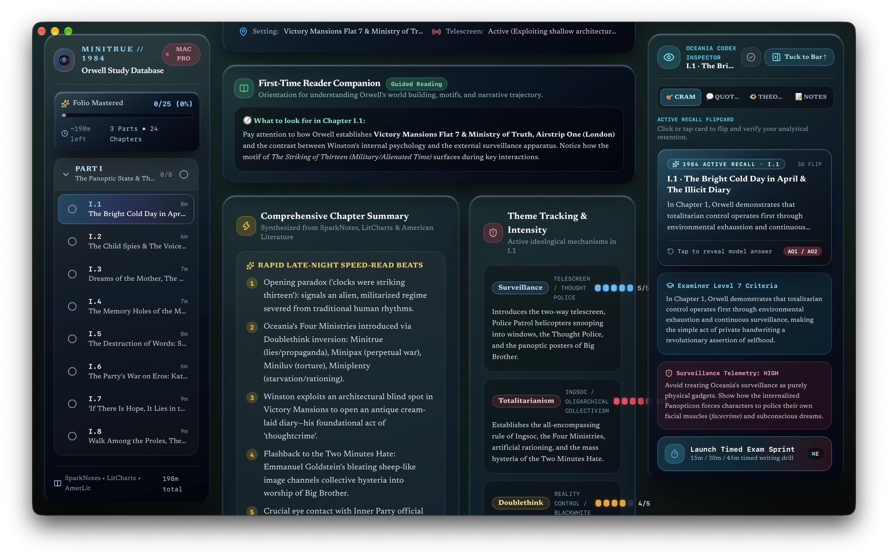
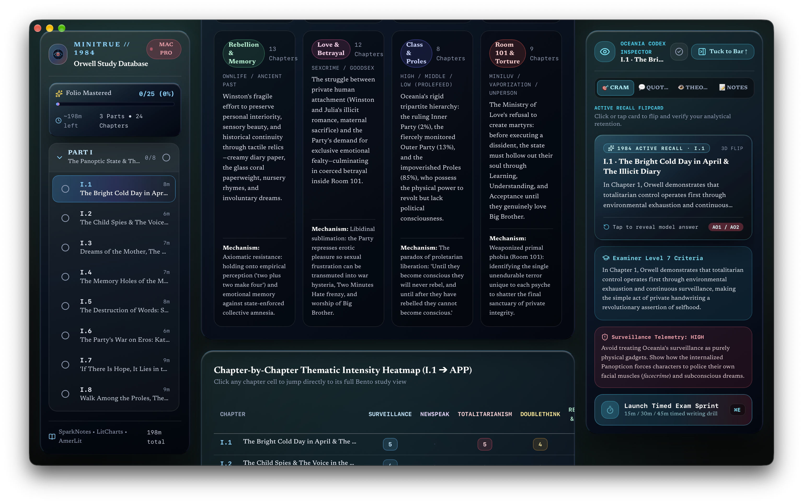
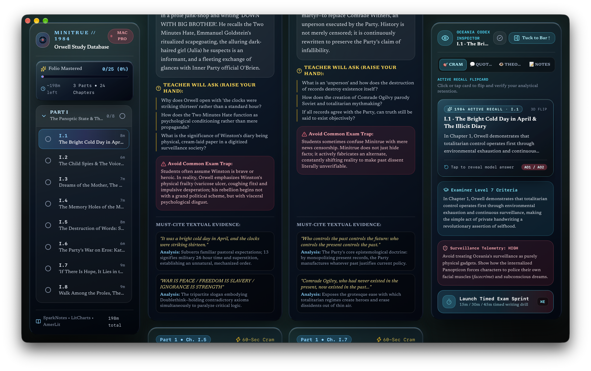
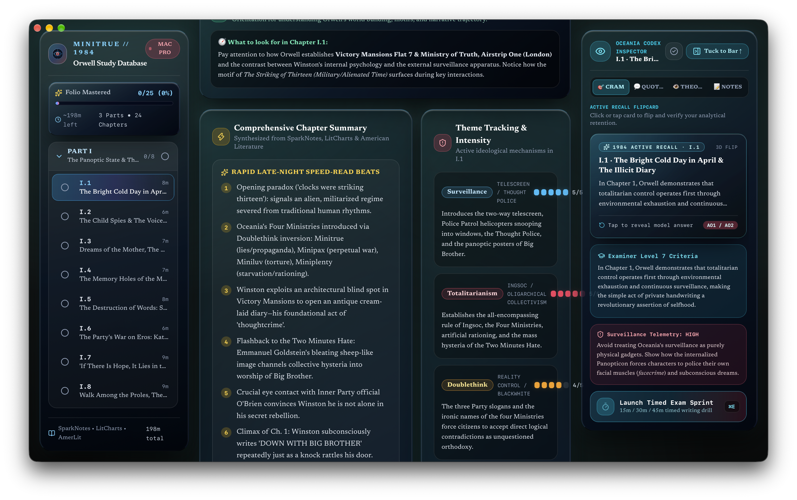
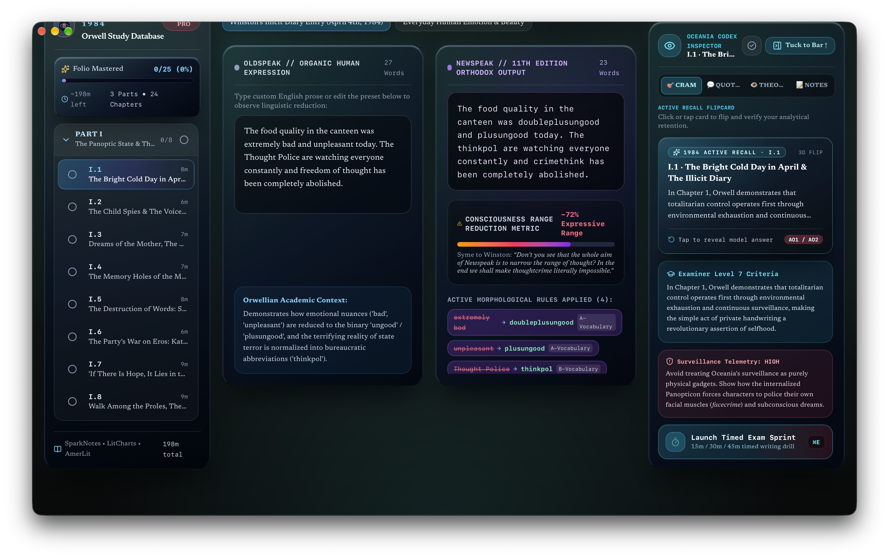

# 👁️ Minitrue Oceania // 1984
### The George Orwell Study Dashboard for macOS & Windows

**Minitrue Oceania** is a native cross-platform application built for International Baccalaureate (IB) Diploma Language & Literature students and Orwellian scholars. It combines exhaustive chapter-by-chapter textual commentary, panoptic surveillance telemetry, Newspeak linguistic analysis, and totalitarian ideological matrices with a cold telescreen-cyan Liquid Glass bento interface, active recall flashcards, an Academic Handwritten Notes Studio, and native desktop widgets across both **macOS** (`.app` / `.dmg`) and **Windows** (`.exe` standalone via Tauri v2).

---

## 📸 Interface Preview & Navigation

### 1. The Command Center (Hero Overview)


The primary launchpad provides a high-level view of your reading progress and current analytical dossier:
* **Oceania Codex Mastery Tracker**: Tracks completion across all 24 chapters across Part One (Airstrip One), Part Two (The Brotherhood & Charrington's Room), and Part Three (The Ministry of Love) in real time.
* **Panoptic Navigation Sidebar**: Jump straight into any chapter with surveillance threat telemetry, telescreen status indicators, and completed scene checks.
* **Chapter Dossier Bento**: Unpacks Winston Smith's psychological rebellion, the Two Minutes Hate, Parsons' family betrayal, and Goldstein's forbidden treatise.
* **Global Spotlight Search**: Press `⌘K` (macOS) or `Ctrl+K` (Windows) to search across all chapters for specific Oceania axioms, Newspeak vocabulary, symbols (coral paperweight, church bells), and critical characters.

---

### 2. Analytical Hub & Theme Matrix


Designed specifically for IB Paper 1 (Non-Literary / Prose Analysis), Paper 2 (Comparative Essay), and Individual Oral (IO) preparation:
* **Core Totalitarian Themes Matrix**: Filter textual evidence across Surveillance & Panopticism, Doublethink & Epistemic Control, Newspeak & Linguistic Determinism, Physical Rebellion vs. Mental Capitulation, and Social Class Polarization.
* **High-Scoring Quotation Anchors**: Key quotes paired with stylistic breakdowns, psychological context, and authorial purpose (e.g. *“Freedom is the freedom to say that two plus two make four”*).
* **Character Psychological Trajectories**: Chart Winston’s journey from silent thoughtcrime in his illegal diary to total capitulation in Room 101 alongside Julia and O'Brien.

---

### 3. Active Revision & Continuous Flow


* **Continuous Flow Reading Stream**: Read uninterrupted critical commentaries and speed-read chapter summaries in a vertical panoptic stream.


* **Active Recall Flashcards**: Test memory on key quotes, Newspeak definitions, and historical context notes.
* Switch between modes at any time using the Study and Revision toggle in the top bar.

---

### 4. ✍️ Academic Handwritten Notes Studio
A distraction-free, analog-feel digital notebook seamlessly embedded inside the analytical inspector and chapter cards:
* **Ruled Notebook Texture**: Authentic 28px repeating guide lines engineered specifically for textual analysis and close commentary.
* **Curated Academic Handwriting Typography**: Precision-styled cursive font stack featuring *Caveat*, *Kalam*, *Noteworthy*, and *Snell Roundhand*.
* **Live Telemetry Console**: Real-time counter tracking words, characters, and reading duration.
* **Action Shortcuts**: Quick bullet insertion (`• Bullet`), quotation framing (`"Quote"`), one-click clipboard copying, and canvas reset.
* **100% Offline Persistence**: Automatically persists draft arguments and notes on-device via `localStorage`.

---

### 5. Newspeak Lexicon & Ministry Dossier


* **Newspeak Dictionary**: Comprehensive breakdown of vocabulary categories (A, B, and C vocabularies), duckspeak, crimethink, unperson, joycamp, and facecrime.
* **4 Ministries Architecture**: Detailed operational analysis of Minitrue, Minipax, Miniluv, and Miniplenty.

---

### 6. Desktop Widgets (macOS WidgetKit)
Keep revision top-of-mind without keeping the full app open:
* **Live Study Counter**: Displays active reading streak, remaining chapters, and current chapter focus on your macOS desktop wallpaper or Notification Center.
* **Multi-Size Liquid Glass Templates**: Available in Small, Medium, and Large dossier formats.
* **Local Offline Sync**: Synchronizes instantly across macOS without requiring an account login or network connection.

---

## ⌨️ Keyboard Shortcuts

* `⌘ + K` / `Ctrl + K`: Open quick Spotlight search for chapters, quotes, and themes
* `⌘ + B` / `Ctrl + B`: Toggle sidebar navigation drawer
* `⌘ + I` / `Ctrl + I`: Toggle Pro Analytical Inspector
* `⌘ + E` / `Ctrl + E`: Launch Timed Exam Sprint mode
* `1`: Switch to Single Chapter Bento view
* `2`: Switch to Continuous Flow stream view
* `3`: Switch to Active Recall & Cram hub
* `4`: Switch to Totalitarian Theme Matrix view
* `5`: Switch to Newspeak Lexicon & Dossier

---

## 🛠️ Technical Highlights & Architecture

* **Modern Web Core**: Built using Next.js 16, React 19, and Tailwind CSS.
* **Native macOS Shell**: Runs inside an Apple AppKit and WKWebView container with smooth 120 FPS animations.
* **Native Windows Shell**: High-efficiency standalone executable compiled via **Tauri v2** and Microsoft Edge WebView2 (~8.4 MB executable).
* **On-Device Storage**: Local state management persists notes and progress directly on your device via Zustand and `localStorage`.
* **Zero Dependencies**: Fully self-contained local build requiring no external cloud databases.

---

## 📦 Downloads & Installation

| Platform | Format | Release Asset | Notes |
| :--- | :--- | :--- | :--- |
| 🍎 **macOS** | `.dmg` Installer | [**`Orwell1984Codex-macOS-v1.0.1.dmg`**](https://github.com/ayaandev09/1984-orwell-macos-study-app/releases/download/v1.0.1/Orwell1984Codex-macOS-v1.0.1.dmg) | Drag-to-Applications disk image with `First-Time Open Helper.command` |
| 🪟 **Windows** | `.exe` Standalone | [**`Orwell1984Codex-Windows-v1.0.1.exe`**](https://github.com/ayaandev09/1984-orwell-macos-study-app/releases/download/v1.0.1/Orwell1984Codex-Windows-v1.0.1.exe) | Standalone portable executable powered by Tauri v2 & WebView2 |

### 🍎 macOS Installation Instructions
1. Download [**`Orwell1984Codex-macOS-v1.0.1.dmg`**](https://github.com/ayaandev09/1984-orwell-macos-study-app/releases/download/v1.0.1/Orwell1984Codex-macOS-v1.0.1.dmg) and double-click to open.
2. Drag the **1984 Oceania App** into your `/Applications` folder.
3. Launch the app. If macOS Gatekeeper flags an unnotarized developer alert:
   - Double-click the included `First-Time Open Helper.command` inside the DMG, or
   - Right-click the app in `/Applications` and select **Open**, or go to **System Settings → Privacy & Security** and click **Open Anyway**.

### 🪟 Windows Installation Instructions
1. Download [**`Orwell1984Codex-Windows-v1.0.1.exe`**](https://github.com/ayaandev09/1984-orwell-macos-study-app/releases/download/v1.0.1/Orwell1984Codex-Windows-v1.0.1.exe) directly.
2. Place the executable in your preferred directory (e.g., Desktop or `Program Files`).
3. Double-click to launch. If Windows SmartScreen displays *"Windows protected your PC"*, click **More info** → **Run anyway**.

## 🏗️ Building from Source

### Web Bundle
```bash
npm install
npm run build
```

### Windows Standalone (.exe via Tauri v2)
```bash
# Direct build on Windows
cargo tauri build

# Or cross-compile from macOS with cargo-xwin
cargo xwin build --release --target x86_64-pc-windows-msvc
```

---

## 🎓 IB CAS Alignment

* **Creativity**: Designing and programming an authentic panoptic user interface inspired by Orwellian retro-futurism, complete with custom Liquid Glass caustic shaders, handwritten notes canvas, and native macOS widgets.
* **Service**: Providing secondary school literature students globally with a distraction-free, open-access revision environment for their IB Diploma exams.
